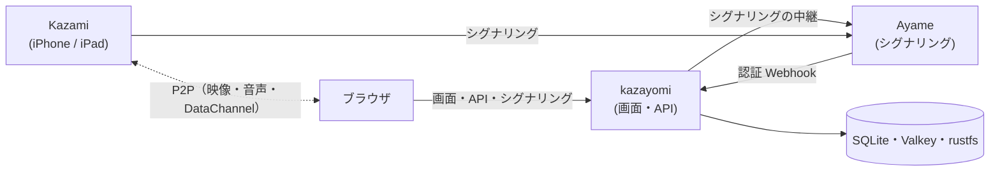

# kazayomi

iPhone / iPad のカメラアプリ **Kazami** の映像を、WebRTC（P2P）でブラウザに映す Web アプリです。
シグナリングには [Ayame](https://github.com/OpenAyame/ayame) を使います。

## できること

- **ゲストとして試す**：アカウントなしで、ニックネームと同意だけで始められます。一時的なルームが 1 つでき、Kazami を QR で登録すると映像を見られます。ニックネームも撮像した画像もサーバには保存しません（画像はブラウザに直接ダウンロード）
- **映像を見る**：双方向の音声、カメラの遠隔操作（倍率・フォーカス・色合い・露出）、映像のダブルクリックでフォーカス、複数のカメラを並べるマルチビュー
- **撮像して整理する**（メンバー）：ライブラリ（日付・ルーム・タグでの絞り込み）、図形の描き込み、アルバム、ZIP 書き出し
- **グループで分ける**（メンバー）：ルーム・画像・アルバムはグループごとに見える範囲が分かれ、グループごとに容量の上限を付けられます
- **ルームを守る**：Ayame の認証 Webhook で、ルームの持ち主と、登録した Kazami だけが入れます

## 構成



- 映像はブラウザと Kazami の P2P で、kazayomi は通りません
- バックエンドは Python（FastAPI）、画面は Vue 3 ＋ Vuetify ＋ TypeScript です

## 手元で試す

```bash
cp .env.sample .env   # APP_SESSION_SECRET と RUSTFS_* を埋める
docker compose up -d --build
```

`http://<この PC の IP>:8080` を開きます。最初の設定（サーバ・ルーム・デバイスの登録）は [docs/guide.md](docs/guide.md) にあります。

## 開発

```bash
docker compose --profile dev up -d ayame-dev valkey rustfs
cd backend && cp .env.sample .env && uv sync && uv run python main.py
cd frontend && npm install && npm run dev
```

`http://localhost:5173` を開きます。`backend/.env` の `APP_ENV=local` で Google ログインを省けます（画面上部に警告が出ます）。

```bash
cd backend && uv run pytest
cd frontend && npm run build   # 型チェックもする
```

## ドキュメント

| | |
|---|---|
| [docs/guide.md](docs/guide.md) | 使い方と設定（最初の設定、Kazami の登録、撮像の仕組み、環境変数、困ったとき） |
| [docs/app-spec.md](docs/app-spec.md) | 仕様（画面・権限・ゲスト・DataChannel の取り決め・API） |

## ライセンス

[Apache License 2.0](LICENSE)
