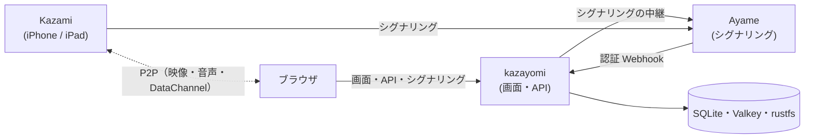

# kazayomi

iPhone / iPad のカメラアプリ **Kazami** の映像を、WebRTC（P2P）でブラウザに映す Web アプリです。
シグナリングには [Ayame](https://github.com/OpenAyame/ayame) を使います。

自分たちのサーバ（オンプレミス・社内ネットワーク・自前の VM）に置いて、登録したメンバーだけで使うためのものです。
アカウントなしで使えるゲストの機能はありません。

## できること

- **映像を見る**：双方向の音声、カメラの遠隔操作（倍率・フォーカス・色合い・露出）、映像のダブルクリックでフォーカス、複数のカメラを並べるマルチビュー
- **撮像して整理する**：ライブラリ（日付・ルーム・タグでの絞り込み）、図形の描き込み、アルバム、ZIP 書き出し
- **グループで分ける**：ルーム・画像・アルバムはグループごとに見える範囲が分かれ、グループごとに容量の上限を付けられます
- **ルームを守る**：Ayame の認証 Webhook で、ルームの持ち主と、登録した Kazami だけが入れます

## 構成



- 映像はブラウザと Kazami の P2P で、kazayomi は通りません
- バックエンドは Python（FastAPI）、画面は Vue 3 ＋ Vuetify ＋ TypeScript です

## 手元で試す

```bash
cp .env.sample .env   # APP_SESSION_SECRET・RUSTFS_*・PUBLIC_BASE_URL を埋める
docker compose up -d --build
```

`http://<この PC の IP>:8080` を開きます。http で IP を開くときは Google ログインを使えないので、`.env.sample` のとおり `APP_ENV=local` でログインを省きます（開いた人は誰でも管理者になるので、信頼できるネットワークの中だけで使ってください）。初めて起動したときにサーバ・ルーム・デバイスが 1 つずつ作られるので、マスター › デバイス から登録 QR を出して Kazami で読み取れば試せます。

Google ログインで複数の人で使う手順（https のドメインが要る）は [docs/guide.md](docs/guide.md) にあります。

## 開発

```bash
docker compose --profile dev up -d ayame-dev valkey rustfs
cd backend && cp .env.sample .env && uv sync && uv run python main.py
cd frontend && npm install && npm run dev
```

`http://localhost:5173` を開きます。`backend/.env` の `APP_ENV=local` で Google ログインを省けます（画面上部に警告が出ます）。このとき初めて起動すると、サーバ「ローカルの Ayame」・ルーム「ローカルのルーム」・デバイス「ローカルの Kazami」を 1 つずつ作るので、マスター › デバイス から登録 QR を出すだけで試せます。Kazami から届くよう、`backend/.env` の `PUBLIC_BASE_URL` に PC の IP の URL（例: `http://192.168.1.10:8080`）を入れておいてください。サーバの URL は、そのホストの 3000 番（`ayame-dev`）で作ります。

```bash
cd backend && uv run pytest
cd frontend && npm run build   # 型チェックもする
```

## ドキュメント

| | |
|---|---|
| [docs/guide.md](docs/guide.md) | 使い方と設定（最初の設定、Kazami の登録、撮像の仕組み、環境変数、困ったとき） |
| [docs/app-spec.md](docs/app-spec.md) | 仕様（画面・権限・DataChannel の取り決め・API） |

## ライセンス

[Apache License 2.0](LICENSE)

使っているオープンソースソフトウェアのライセンス文は、ビルドのときに集めて同梱します。画面では右上のユーザーメニュー →「ライセンス」から開けます。

| 対象 | 集め方 | 置き場所 |
|---|---|---|
| 画面（npm） | `npm run build` で、バンドルに入ったパッケージから集める | `frontend/dist/licenses/frontend.txt` |
| サーバ（Python） | コンテナのビルドで `backend/scripts/third_party_licenses.py` を実行する | イメージの `/app/frontend/dist/licenses/backend.txt` |
| Ayame（Go） | `deploy/ayame/Dockerfile` で、Ayame 本体・依存モジュール・Go のライセンスを集める | Ayame イメージの `/licenses/` |
