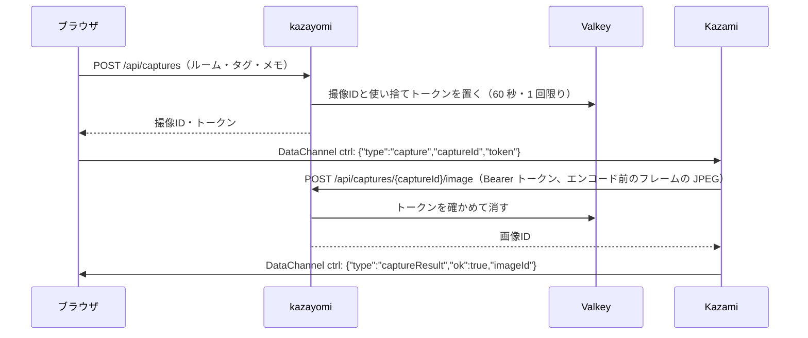

# 使い方と設定

README より詳しい、動かし方・設定・困ったときの確認です。仕様は [app-spec.md](app-spec.md) にあります。

Kazami は、映像を送る側の iPhone / iPad のカメラアプリです（kazayomi とは別のアプリ）。

## 手元で試す（docker compose）

手元の PC で動かし、`http://<この PC の IP>:8080` で開く方法です。Google ログインは、http では `localhost` でしか使えず、IP アドレスの URL も登録できません。そのため、この方法では `APP_ENV=local` でログインを省きます。

> [!WARNING]
> `APP_ENV=local` の間は、画面を開いた人は**誰でも管理者**（開発ユーザー `dev@example.com`）として扱われます。自分の PC の中か、信頼できるネットワークの中だけで使ってください。画面の上部には常に警告が出ます。

1. compose.yaml と同じ場所に `.env` を作る（`.env.sample` を写す）

   ```bash
   cp .env.sample .env
   ```

   | 変数 | 内容 |
   |---|---|
   | `APP_ENV` | `local`（`.env.sample` に入っている） |
   | `PUBLIC_BASE_URL` | iPhone から開ける kazayomi の URL（例: `http://192.168.1.10:8080`）。登録 QR に入り、初めに作るサーバの URL（このホストの 3000 番）にも使う |
   | `APP_SESSION_SECRET` | 必須。`python3 -c "import secrets; print(secrets.token_urlsafe(64))"` で作る |
   | `RUSTFS_ACCESS_KEY` / `RUSTFS_SECRET_KEY` | 必須。画像の置き場（rustfs）のアクセスキー。`python3 -c "import secrets; print(secrets.token_urlsafe(24))"` で作る |

2. 起動する

   ```bash
   docker compose up -d --build
   ```

3. `http://<この PC の IP>:8080` を開く。初めて起動したときは、次の 3 つが作られている
   - サーバ「ローカルの Ayame」（既定のサーバ。URL は `PUBLIC_BASE_URL` のホストの 3000 番。例: `ws://192.168.1.10:3000/signaling`）
   - ルーム「ローカルのルーム」（グループ `default`）
   - デバイス「ローカルの Kazami」（上のルームに割り当て済み）
4. マスター › デバイス で「ローカルの Kazami」の「登録 QR」を出し、Kazami の 設定 › 端末登録 で読み取る。以降はルームに自動でつながる

- シグナリング：`ws://<この PC の IP>:3000/signaling`（Kazami と kazayomi がつなぐ。ブラウザは kazayomi 経由）
- Ayame は kazayomi と同じネットワーク名前空間（`net` コンテナが持つ。ポート 8080・3000 もここで公開する）で動き、認証 Webhook を `http://127.0.0.1:8080` で呼びます。`.env` を変えて kazayomi だけ作り直されても、Ayame は切れません。kazayomi は Webhook に 127.0.0.1 からの呼び出しにだけ答え、プロキシを通ったもの（`X-Forwarded-For` などが付いたもの）は断ります
- 画像とサムネイルは rustfs（ボリューム `rustfs-data`、バケット `kazayomi`）、DB はボリューム `kazayomi-data` に入ります
- rustfs の API（9000）とコンソール（9001）は、この PC の中（127.0.0.1）からだけ開けます。コンソールは `http://localhost:9001/rustfs/console/` です
- 初めの 3 つは 1 回だけ作ります。消しても再起動で作り直しません。すでにサーバかルームがある DB でも作りません

## Google ログインで動かす

複数の人で使うときは、Google ログインにして、人ごとにロールとグループを分けます。Google ログインには **https で開けるドメイン**が要ります（リバースプロキシや Cloudflare Tunnel などで kazayomi の 8080 番につなぐ）。

1. `.env` を次のようにする
   - `APP_ENV` の行を消す（空なら production 扱い）
   - `GOOGLE_OAUTH_CLIENT_ID`：Google Cloud Console で作る「ウェブアプリケーション」の OAuth クライアント ID。「承認済みの JavaScript 生成元」に、画面を開く URL（例: `https://kazayomi.example.com`）を完全一致で登録する
   - `BOOTSTRAP_ADMIN_EMAILS`：最初の管理者のメールアドレス。起動時に、いなければ登録する
   - `PUBLIC_BASE_URL`：`https://kazayomi.example.com` のように、iPhone から開ける URL
   - `SESSION_HTTPS_ONLY=true`
2. `docker compose up -d --build` で起動し、管理者でログインする
3. 最初にすること
   1. マスター › グループ を作る（`default` が最初からある）
   2. マスター › サーバ に Ayame のシグナリング URL を登録し、「既定のサーバ」にする（サーバを選んでいないルームが使う。最初に登録したサーバは既定になる）。URL は **kazayomi と Kazami の両方から届くもの**（例: `ws://192.168.1.10:3000/signaling`）。コンテナで動かすときの `localhost` はコンテナ自身を指すので使えない
      - 既定のサーバがないと、サーバを選んでいないルームにはつなげない（画面にそう出る）
      - 社外のネットワーク同士など、直接つながらない相手と映像をやり取りするときは、種類を「Ayame + Cloudflare TURN」にして、Cloudflare ダッシュボードの Realtime → TURN で作ったキーの ID と API トークンを入れる。入室のたびに TURN の認証情報が発行され、ブラウザと Kazami に渡る
   3. マスター › ルーム に Kazami のルームを登録する（グループとサーバを選ぶ）
   4. マスター › デバイス に Kazami 端末を追加し、ルームを割り当てて「登録 QR」を出す
   5. Kazami の 設定 › 端末登録 で QR を読み取る。以降は割り当てたルームに自動でつながる
   6. マスター › メンバー で、グループの管理者やメンバーを招待する（マスター › ユーザー でアプリ全体のロールも付けられる）

## Kazami（iPhone / iPad のカメラアプリ）の設定

登録 QR を読み取れば、ほかの設定は要りません（ルームID・シグナリング URL・撮像の送り先は kazayomi から受け取ります）。

- QR には kazayomi の URL と、1 回限り・5 分で切れる登録トークンだけが入っています
- Kazami は端末の中で署名鍵を作り（実機は Secure Enclave）、起動のたびにそれで認証します
- QR に入れる kazayomi の URL はサーバが決め、画面では変えられません（変えられると、よそのサーバに映像を送らせる QR を作れてしまうため）。`PUBLIC_BASE_URL` があればそれ、無ければ画面を開いている URL です。iPhone から開ける URL を `PUBLIC_BASE_URL` に設定してください（`localhost` は iPhone 自身を指します）
- Kazami は読み取った接続先を確認の画面に出し、`https://ホスト[:ポート]` か `http://ホスト[:ポート]` の形でないもの（パス・クエリ付きなど）は受け付けません
- 端末をなくした・入れ替えるときは、マスター › デバイス で「登録を外す」

## 撮像の仕組み

撮り方は 2 つあります。

- **Kazami の撮像ボタン**：Kazami がフレームを JPEG にして `POST /api/devices/images` にデバイスのアクセストークンで送ります。そのデバイスに割り当てたルームとグループの画像になり、撮像した人は 端末「デバイス名」と出ます
- **kazayomi の撮像ボタン**：次の流れで Kazami に頼みます



DataChannel の取り決めは [app-spec.md](app-spec.md#datachannel-の取り決め) を参照してください。

## ログイン

Google でログインします。ユーザーマスターに登録されていて有効な人、または招待が届いている人だけが使えます。
グループを作れるのはアプリの管理者だけで、メンバーは招待で増やします。
ログインできなかったときは、理由（登録されていない・止められているなど）によらず「ログインできませんでした。」とだけ出します。理由は監査ログに残ります。

メンバーのロールは次のとおりです（グループごとの役割「グループ管理者・編集者・閲覧者」と合わせて、強いほうが効きます）。

| ロール | できること |
|---|---|
| 管理者（admin） | すべて。ユーザー・グループの管理、監査ログ |
| デバイス管理者（device_admin） | 編集者の操作に加えて、サーバ・ルーム・デバイスの管理 |
| 編集者（power） | 閲覧者の操作に加えて、タグ・メモ・図形・アルバムの編集、画像の削除 |
| 閲覧者（user） | 映像を見る・撮像・通話、画像とアルバムを見る |

所属グループのルーム・画像・アルバムだけが見えます（管理者は全グループ）。
マスターの変更・画像やアルバムの削除・ログインは、監査ログ（`data/audit_logs.jsonl`）に残ります。

## 環境変数

| 変数 | 既定値 | 内容 |
|---|---|---|
| `DATA_DIR` | `backend/data`（コンテナは `/data`） | SQLite・監査ログの置き場（rustfs を使わないときは画像も） |
| `AUDIT_LOG_RETENTION_DAYS` | `90` | 監査ログ（ログインの成否・IP アドレス・操作）を残す日数。過ぎたものは消す。`0` なら消さない |
| `APP_SESSION_SECRET` | なし（本番は必須） | セッション Cookie の署名鍵。変えると全員ログアウトになる |
| `GOOGLE_OAUTH_CLIENT_ID` | なし | Google ログインの OAuth クライアント ID |
| `BOOTSTRAP_ADMIN_EMAILS` | なし | 起動時に管理者として登録する人（カンマ区切り） |
| `SESSION_HTTPS_ONLY` | `false` | https で配信するときは `true` |
| `APP_ENV` | production | `local` のときだけログインを省く（「手元で試す」のとき。開いた人は誰でも管理者になる）。初めて起動したときは、サーバ・ルーム・デバイスを 1 つずつ作る |
| `AYAME_WEBHOOK_ALLOWED_IPS` | `127.0.0.1,::1` | 認証 Webhook を呼んでよい接続元（IP か CIDR）。プロキシを通った呼び出しは接続元に関わらず断る |
| `AYAME_WEBHOOK_SECRET` | なし | 追加で Webhook の URL の `?key=` の一致も求めるときに設定する（本番は必須） |
| `PUBLIC_BASE_URL` | なし（画面を開いている URL） | 登録 QR に入れる kazayomi の URL。`https://ホスト[:ポート]` か `http://ホスト[:ポート]` の形だけ（パスは付けない）。形が正しくなければ起動しない |
| `DEVICE_TOKEN_TTL_SECONDS` | `43200` | Kazami のアクセストークンの有効期間 |
| `VALKEY_URL` | なし（メモリ） | トークン類の置き場。gunicorn の worker を 2 つ以上にするなら必須 |
| `S3_ENDPOINT_URL` | なし（`DATA_DIR` の下） | 画像の置き場（rustfs）。compose では `http://rustfs:9000` |
| `S3_ACCESS_KEY` / `S3_SECRET_KEY` | なし | rustfs のアクセスキー |
| `S3_BUCKET` | `kazayomi` | バケット。起動時に無ければ作る |
| `S3_REGION` | `us-east-1` | 署名に使うリージョン名 |
| `CAPTURE_TOKEN_TTL_SECONDS` | `60` | 撮像トークンの有効期限 |
| `MAX_UPLOAD_BYTES` | 30MB | 1 枚あたりの上限 |
| `THUMBNAIL_SIZE` | `320` | サムネイルの長辺（px） |
| `CORS_ALLOWED_ORIGINS` | `http://127.0.0.1:8080,http://localhost:5173` | 開発時の Vite など |
| `PORT` | `8080` | `uv run python main.py` で起動するときのポート（コンテナでは使わない） |
| `TZ` | — | 日付フォルダと日付の絞り込みに使う。コンテナでは `Asia/Tokyo` |

## よくあること

| 症状 | 確認すること |
|---|---|
| ログインボタンが出ない | `GOOGLE_OAUTH_CLIENT_ID` が設定されているか。Google 側の「承認済みの JavaScript 生成元」に、開いている URL が完全一致で入っているか |
| 「〇〇 は登録されていません」 | マスター › ユーザー に登録され、有効になっているか。招待したなら、そのメールアドレスの Google アカウントでログインしているか |
| 「カメラを待っています」のまま | Kazami が起動していて、端末登録が済み、マスター › デバイス でルームが割り当てられているか |
| 「Ayame の認証で断られました」 | ルームとデバイスの割り当て。Ayame のログに認証 Webhook のエラーが出ていないか（`AYAME_WEBHOOK_SECRET` を設定しているなら、Ayame の設定の Webhook の URL の `?key=` と同じか） |
| 「他の画面がこのルームを見ています」 | 別のタブやマルチビューで同じルームを開いていないか（`localhost` と IP で同じ kazayomi を開いている場合も含む） |
| 撮像ボタンが押せない | DataChannel に対応した版の Kazami か（接続欄にデバイス名が出ていれば対応） |
| 「カメラから画像が届きませんでした」 | 登録 QR に入れた kazayomi の URL が、iPhone から届く URL になっているか（`localhost` は iPhone 自身を指す） |
| マイクが使えない | ブラウザのマイクの許可。マイクは https か `localhost` で開いたときしか使えない（`http://<IP>` では映像と撮像だけ） |
| 「kazayomi から Ayame に届きません」 | マスター › サーバの URL に、kazayomi から届くか。コンテナで動かすときは `localhost` ではなく PC の IP にする |
| 映像がつながらない（社外から） | P2P が通らない。TURN（coturn など）が要る |
